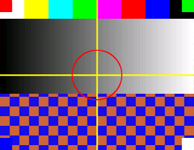

# SSTV Tool for macOS (arm64)

An SSTV transceiver for macOS: **receive** (decode slow-scan television from a rig or a
recording, identifying the mode by itself) and **transmit** (turn a picture into SSTV audio
you can feed to a radio).

[中文](README.md) · English



*A test card sent through PD120 and decoded back from the synthesised audio: crosshair,
grey ramp and colour bars all where they belong.*

It is built on [SodaGray/apricot-sstv](https://github.com/SodaGray/apricot-sstv), an SSTV
receiver for the iPod nano 7:

- The decode core `src/sstv_dsp.c` was taken over untouched (GPL-3.0): demodulation, VIS
  detection, sync-pulse locking when VIS is missing, ppm slope correction, redrawing across
  fades and dropped samples. What was replaced is the capture layer (CoreAudio AUHAL instead of
  the nano's DMA), the display layer (AppKit instead of a 320×240 raw surface) and the save
  layer (ImageIO PNG instead of BMP).
- The transmit side uses the host encoder `tools/enc.c` from the same upstream repo (waveform
  generation for 14 modes), wrapped in macOS: any image format in, letterboxed to aspect ratio,
  optional text overlay, saved as WAV or played straight out. Feature set follows
  [olgamiller/SSTVEncoder2](https://github.com/olgamiller/SSTVEncoder2) (mode pick / keep aspect /
  text overlay / save WAVE / play).

## Receiving: automatic, or holding one mode

Two dropdown choices in the window, and the same thing from the CLI with `--rx-mode`:

- **Auto** (default) — read the VIS header and pick the mode; all 14 are recognised.
- **A fixed mode** (e.g. PD120) — only that one counts; a different VIS is ignored. If the VIS
  is missing or mangled the decoder still locks on the line-sync pulses. This is what you want
  for an ISS pass, a beacon, or any station that keeps sending one mode all evening.

**Continuous output** (the `连续` checkbox, or `--continuous`) skips waiting for a VIS: as soon
as one picture is done the next frame is queued, and it starts on the next frame's first sync
pulse. The gap or repeated VIS between frames costs at most one line.

```sh
sstv-tool --listen --rx-mode pd120 --continuous     # hold PD120, no VIS needed, picture after picture
```

Decoded pictures go to `~/Pictures/SSTV Tool/` (the `.app` runs with `/` as its working
directory and cannot write there; the CLI still writes next to the input or to `--out`).

## Frequency offset is corrected automatically

There is no tuning knob, because there does not need to be one. The decoder measures the offset
from the VIS preamble (or from the sync pulses themselves) and shifts its decision thresholds by
it; the `偏移 -5 Hz` field in the status line is what it measured and already compensated. This
build widened the acceptable range from upstream's ±150 Hz to **±250 Hz** — a dial that is a
couple of hundred hertz off still decodes; anything further is not an offset, it is the wrong
frequency.

`sstv-tool --modes` prints what this build can actually decode (it asks the decoder rather than
reading a hard-coded table). Note that VIS 4 (Robot 24) is recognised by name but not decoded —
upstream never implemented it either, and it shows up as `Skip Robot 24`.

## The window: receive and generate as two tabs

- **Receive**: image preview, status line, the mode dropdown, the `连续` checkbox,
  pause / cancel-this-picture, and the level and tuning meters.
- **Generate**: an editable canvas — drag to pan, scroll to zoom, rotate 90°, flip horizontally
  or vertically, fit as letterbox / crop-fill / stretch, four sliders (text size, zoom,
  brightness, contrast), text overlay with a 3×3 anchor grid, mode picker, and along the bottom
  `生成并播放` (generate and play), `存成 WAV` (save WAV), `停止` (stop).

The preview is not a separate thumbnail: it goes through the same `encode_render_rgb` call the
encoder uses, so what you see on the canvas is what gets transmitted.

The same edits from the command line:

```sh
sstv-tool encode pic.png --mode m1 --rotate 90 --text "CQ DE LAN" --text-pos 5
sstv-tool encode pic.png --mode r36 --pan 0.3,-0.2 --zoom 1.4 --contrast 1.2 --brightness 0.05
sstv-tool encode pic.png --flip-h --text "73" --text-pos 9 --text-scale 1.6
```

## Transmitting: picture to SSTV audio

- **Generate and play** renders the picture and plays it on the default output device, showing
  `正在发射 47% 剩 68 s name-mode.wav` with an orange progress bar; **stop** cuts it at any time.
- **Save WAV** writes straight to `~/Music/SSTV Tool/` and selects the file in the Finder — no
  save dialog, one less place to fail quietly. Hold **Option** while clicking to choose a path.
- The **pause / cancel-this-picture** buttons belong to the receiver and do not affect transmit.

Command-line equivalents (no window):

```sh
sstv-tool --send pic.png --mode pd120            # open the window and transmit, with progress
sstv-tool --send pic.png --mode pd50 --no-play   # generate only
sstv-tool encode pic.png --mode m1 --play        # pure CLI, no window
```

```sh
sstv-tool encode example.jpg                      # Robot 36 by default, example-Robot36.wav alongside
sstv-tool encode photo.png --mode pd120           # mode name, short form or VIS number: pd120 / m1 / s2 / 95
sstv-tool encode photo.png --mode m1 --out ~/Desktop/m1.wav
sstv-tool encode photo.png --mode pd50 --text "CQ CQ DE LAN" --play
sstv-tool encode photo.png --fit letterbox        # default; fill and stretch also work
sstv-tool encode photo.png --mode pd120 --ppm -400 --offset -40 --snr 18   # a deliberately bad signal
sstv-tool encode --list-modes                     # what it can send, and at what size
```

Other flags: `--rate HZ` sample rate (44100), `--lead S` / `--tail S` silence padding,
`--gain F` amplitude (0..1, default 0.37 ≈ −8.7 dBFS — `enc.c` measures against s16 peaks, so a
"0..1" value like 0.9 produces a silent file; one of the self-tests watches exactly this),
`--no-wait` to not block while playing.

Transmit and receive share one mode table, and `make test` closes the loop: encode → decode for
all 14 modes.

## The 14 modes

| Mode | VIS | Frame | Duration | PNG size when decoding |
|---|---|---|---|---|
| Robot 36 | 8 | 320×240 | 36 s | 320×240 |
| Robot 72 | 12 | 320×240 | 72 s | 320×240 |
| Martin M1 / M2 | 44 / 40 | 320×256 | 114 / 58 s | 320×256 |
| Scottie S1 / S2 / DX | 60 / 56 / 76 | 320×256 | 110 / 71 / 269 s | 320×256 |
| PD50 / PD90 | 93 / 99 | 320×256 | 50 / 90 s | 320×256 |
| PD120 | 95 | 640×496 | 126 s | 320×248 (half size) |
| PD160 | 98 | 512×400 | 161 s | 256×200 (half size) |
| PD180 / PD240 | 96 / 97 | 640×496 | 187 / 248 s | 320×248 (half size) |
| PD290 | 94 | 800×616 | 289 s | 400×308 (half size) |

Modes wider than 400 px are stored at half size on receive (upstream keeps a fixed buffer, sized
for Robot 36); each output pixel averages two lines of samples per sync. `--scale 2` saves the PNG
at double size (nearest-neighbour — easier on the eye, no extra detail). Transmitting always uses
the mode's native frame size.

## Building

Xcode Command Line Tools (clang) are enough. arm64 native, no third-party libraries.

```sh
make                # build/sstv-tool + build/SSTV Tool.app + the test-signal tools
make test           # receive/transmit suite: 14 modes decoded, 14 encode→decode loops,
                    # damaged signals, back-to-back reception
make test-pause     # pause / cancel at real speed (~90 s)
sudo make install   # /usr/local/bin/sstv-tool (optional)
```

## Receiving from the command line

```sh
sstv-tool ~/Desktop/sdr-2026-11-06.wav      # wav/aiff/m4a/flac/caf — anything CoreAudio reads
# → sdr-2026-11-06-1.png, -2.png … alongside; a half-captured signal still gets a PNG

sstv-tool --listen                          # live from a rig or a radio's speaker
sstv-tool --list                            # device numbers first
sstv-tool --listen --device 1
sstv-tool --listen --no-view                # no window: log lines and automatic saves

sstv-tool --simulate recording.wav          # replay a file through the live path at real speed
```

More flags: `--out DIR`, `--prefix NAME`, `--scale N`, `--no-autosync`, `--ppm N` (clock prior),
`--quiet`.

In the window, three status rows (mode and line count, tuning Hz and offset, clock ppm, sync x/y,
level dBFS, files saved) sit above two meters; the red band on the tuning meter is the
1500–2300 Hz sync/porch region.

You can interrupt a capture at any point:

| Action | Button | Key | Headless |
|---|---|---|---|
| Pause / resume | `暂停` → `继续` | space | `kill -USR1 <pid>` |
| Abandon this picture | `取消这张` | X | `kill -USR2 <pid>` |
| Quit | close the window | Q / Esc | Ctrl-C |

While paused the picture freezes and dims, audio keeps being captured (the meter still moves) but
is not fed to the decoder, and the skipped samples are accounted for on the timeline, so resuming
does not skew the image. A pause of roughly ten seconds or less resumes on the same line; a longer
one is treated as signal loss, and the partial picture is closed and saved. "Cancel this picture"
keeps whatever was already decoded (`image ended (aborted)`).

## Installing as an app

```sh
make app && cp -R "build/SSTV Tool.app" /Applications/
open -a "/Applications/SSTV Tool.app"
```

`SSTV Tool.app` is its own TCC identity, so the microphone grant is recorded under
`com.lan.sstv-tool` (bundle id). The signature is ad-hoc, keyed to the binary hash, so **every
rebuild asks for microphone access again** — click Allow. The CLI runs under your terminal's
identity, which therefore needs Microphone permission in System Settings → Privacy & Security.

The icon is `assets/AppIcon-1024.png` (a decoded test card, rounded by `tools/makeicon.c`);
`make icon SRC=other.png` regenerates it, and the Makefile turns it into `AppIcon.icns` with
`sips` + `iconutil`.

## "Scan the whole frame before ending" is the default

The decoder no longer gives up on a timeout: once a frame starts it keeps going for that frame's
full duration, leaving white where the signal dropped out, and only closes the picture after all
496 lines (or that mode's count). If the signal comes back mid-frame it picks up where it was.

```sh
sstv-tool rec.wav              # default: scan the whole frame, no timeout
sstv-tool rec.wav --lost 12    # upstream behaviour: give up after 12 s without sync
```

Measured: a 60-second hole punched out of a PD120 still ends `496/496`, colour bars and grey ramp
on top, one blank band in the middle, checkerboard landing in the right place — the timeline did
not slip.

Frames whose sync hit rate is below 10% (noise pretending to be a frame) are not saved; the log
says `frame dropped`.

How a capture ended, as shown in the first status row:

| Shows | Meaning |
|---|---|
| `完成` (complete) | the whole frame was scanned |
| `中断·图已保留，等它回来对齐` (interrupted, picture kept, waiting to re-align) | only possible with `--lost`; nothing is lost — it re-aligns and continues when the signal returns |
| `被新信号打断` (interrupted by a new signal) | a spurious VIS in the middle; use a cleaner source |
| `已取消` (cancelled) | cancel button or SIGUSR2 |

Dropped samples (a stalled machine, a ring-buffer overrun) and a fading signal are handled
separately:

- **Dropped samples** go through `sstv_gap`: the timeline advances exactly, the picture is *not*
  abandoned, only those lines are left blank. The suite punches a 15-second hole and still gets
  496/496 (`capture dropout PASS`). The app holds off App Nap with
  `beginActivityWithOptions(NSActivityLatencyCritical)` and shows the running `丢样 N` count.
- **A signal that really stops** is only declared lost after the timeout; the half picture is
  saved as `xxx-partial1.png` (not part of the numbering) and, if sync returns on the same grid,
  the decoder re-aligns, continues drawing, and removes the partial file.

`.app` launches have no terminal, so the event log goes to `~/Library/Logs/SSTV Tool.log` —
that is the first place to look when something misbehaves.

## Hooking up hardware

- Receive: a speaker into a microphone does work but is unstable. Use a cable into line-in (a USB
  sound card) or a resistive attenuator to bring speaker/line level down to microphone level.
- Transmit: `--play` sends the WAV to the default output; wire that into the rig's mic/data input
  and set the level with `--gain` — do not drive the ALC to the top.
- Sample rate is not your problem: AUHAL does not resample on input, so the app tries the device's
  native rate, then 48k, 44.1k, 32k and uses whichever works. The decoder itself takes 8k–48k.
- Clock error is fitted by the decoder (reported in ppm), so a few hundred ppm between the two
  ends still ends up straight.

## What the test suite covers

- Each of the 14 modes encoded then decoded, checking the PNG size, the completion state and the
  sync hit count.
- **All 14 modes through this tool's own transmit→receive loop** (picture → WAV → picture).
- PD120 with −400 ppm clock error, −40 Hz detune and 18 dB SNR: still a complete picture, and the
  ppm is reported back.
- PD120 without any VIS: autosync starts the picture from the sync pulses alone.
- Back-to-back: Martin M1 + PD90; four modes in a row; six frames with no gap; six frames with a
  4-second gap between each.
- Several files in one invocation with `--prefix`: numbering continues instead of overwriting.

Pictures also inspected by eye: Robot 36 / PD120 / PD290 colour bars, grey ramp, boxes and circles
are correct, no skew or colour displacement; `--text` overlays are legible in the decoded result.

## Known limits

- On receive, PD120/160/180/240/290 are stored at half size — upstream's `SSTV_MAX_W 400` memory
  constraint, with the image buffer `IMG_BYTES` sized for Robot 36. Full size would mean reworking
  upstream's memory layout. Transmit is full size.
- No Wraase SC2 180 (SSTVEncoder2 has it) — upstream's mode table does not include it.
- Acoustic end-to-end on this machine (speaker → webcam mic) flips VIS bits: noise and room
  reverb, not a decoder problem. Line-in is the only honest test.

## Licence

GPL-3.0, inherited from upstream. `src/sstv_dsp.c`, `src/sstv_dsp.h` and `tools/enc.c`,
`tools/sstv_tx.c`, `tools/util.c` come from SodaGray/apricot-sstv unmodified; `src/main.m`,
`src/encode.m`, `src/audio_in.c`, `src/image_out.c`, `src/generate.m` are the new macOS shell.

Copyright (C) 2026 LAN (BI7KGI). See `NOTICE`.
